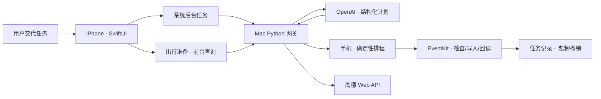

# 鲸伴 · 不抢占手机前台的日程与出行助手

**演示交付版 v0.2.0（Build 2） · 2026-10-02**

用户提交任务后，可继续在同一台 iPhone 上聊天、打字或刷视频；鲸伴通过系统后台任务执行日程规划、冲突检查、EventKit 写入和回读验证。Mac 运行本地模型与地图网关，手机负责日历执行。**这是范围明确的端到端原型，不是通用跨 App 操作 Agent。**

**已实现**：自然语言新建多日任务、固定会议与灵活排程、提醒/备注/链接、独立日历、出发预留、冲突日历选择；失败原因与受限重试、草稿恢复、任务折叠、活动列表、改期预览/历史与撤销核对；地点搜索、公交/驾车/步行方案、路线摘要及高德链接转日程草稿。

## 本地部署
1. Mac 安装 Xcode、Python 3.10+；打开 `WhaleCompanion.xcodeproj`，在 Signing & Capabilities 选择自己的 Team，连接开启开发者模式的 iPhone 后运行。工程最低目标 iOS 26；用户已验收设备为 iPhone 15 Pro / iOS 27.0.1，未覆盖全部支持版本。
2. 双击 `server/start.command`，隐藏输入 OpenAI Key，可选择存入 Mac 登录钥匙串。可选高德 **Web 服务** Key 通过 `server/configure.command` 配置，配置后重启服务。无需第三方 Python 包。
3. 手机与 Mac 连接可互通的可信局域网，在 App 设置填写终端显示的 `http://<Mac-IP>:8765`，授权本地网络和完整日历访问。Mac 服务保持运行；正常使用不依赖 USB。
4. 提交带日期和时长的新任务，切到其他 App，完成后核对回执与系统日历。演示前停止 Xcode 调试，从手机桌面手动启动，重复完整流程。

配置：`MODEL_API_KEY` 必需；`MODEL_BASE_URL` 默认 `https://api.openai.com/v1`；`MODEL_NAME` 默认 `gpt-5`；`AMAP_API_KEY` 可选。`.env.example` 仅示例，程序不自动加载 `.env`。密钥不填入手机，不提交到 Git。

## 验证与边界
`python3 -m unittest discover -s tests -p 'test_*.py'`；Swift 排程验证与详细部署见[部署手册](docs/DEPLOYMENT.md)。用户已反馈真机后台执行、路线转日程、改期及保护测试通过；不等于所有环境下可靠性保证。系统可以拒绝或结束后台任务，可能显示进度；地图查询需前台，改期通过控件确认，自然语言改期仅作常见表达拦截。局域网 HTTP 网关无鉴权，**不应直接暴露公网**。

[版本说明](docs/RELEASE_NOTES.md) · [架构与技术决策](docs/ARCHITECTURE.md) · [演示与答辩手册](docs/DEMO_DEFENSE.md) · [验收记录与限制](docs/VALIDATION.md) · [Git 提交说明](docs/GIT_SUBMISSION.md)
