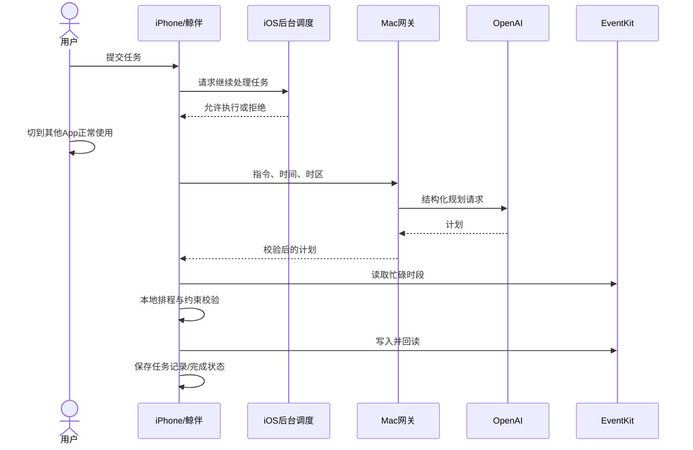

# 架构与技术决策

## 一次日程任务
1. SwiftUI 接收任务，手机保存任务记录；检查空输入、常见修改表达、同日相同文本重复提交。
2. 请求 `BGContinuedProcessingTask`，采用 fail 策略，系统不接受则显示失败。执行并不等同于永久后台驻留。
3. Mac `/plan` 收到任务文字、当前时间及时区，调用 OpenAI Responses API（默认 gpt-5、low reasoning、严格 JSON Schema、store:false、8000 输出 token 上限）。
4. Python 校验计划日期、跨度、数量、时长、提醒、每项时间窗与链接来源。接口结构正确不代表模型语义必然正确。
5. 手机读取参与冲突检查的日历。确定性排程先预留固定活动与出发时间，再将灵活任务放入允许时段；规划失败则不进入写入。
6. EventKit 暂存整批事件后 commit，随后回读标题、时间、备注、链接、地点和提醒。成功后保存事件标识与回执。

## 为什么这样选
- **EventKit**：授权后能直接读写日历数据，不需要打开日历界面、模拟点击或占用用户键盘。代价是只覆盖系统公开接口允许的能力。
- **模型做提取，本地代码做约束**：自然语言交给模型；冲突、时间边界、外部修改保护由代码检查。无需训练自有模型，也不把日历全部发送给模型。
- **Mac 网关**：题目允许电脑协助，可集中保护服务商 Key、切换模型并排查网络。代价是演示依赖 Mac 和局域网。
- **系统后台继续处理**：贴合用户主动提交后继续使用手机的场景。不采用静音音频等保活手段，不声称系统一定给足执行时间。
- **地图采用 Web API**：用户明确选择地点，服务端查询；不要求控制高德 App 或持续定位。点击路线链接才跳转到高德。

## 改期和撤销
改期只针对任务记录中的已完成活动：先按归属、快照、权限和非重复事件校验；关联出发预留依据生成标题与相邻时间识别。预览冲突后用户确认，提交前再次核对事件与冲突，回读成功后记录改期历史。候选空档在接下来七天 09:00–18:00 以半小时检查，最多三个；不是全局最优规划。

撤销先定位原事件，必要时在原任务最早日期前一年至后三年检索。新事件具有独立日程标记，旧记录采用较保守的匹配。已修改事件显示当前时间并要求明确确认；未定位不能推断已删除，也不阻止其他已确认事件处理。用户可确认未定位项已手动删除后结束记录。

## 出行数据流
城市/关键词 → 高德 POI 候选 → 用户选择坐标 → 公交（含夜班）、驾车或步行查询 → 路线摘要/详细指引/高德链接 → 用户载入日程草稿 → 正常排程流程。地图查询目前在前台；写入日历不自动跳转高德。高德链接按起终点重新查询，不承诺锁定当前方案。

## 存储与信任边界
- 手机 Documents：tasks.json、receipts.json；UserDefaults：草稿、服务地址、日历偏好。数据随 App 删除可能丢失，无自建云同步。
- Mac：服务商 Key 可在登录钥匙串；API 请求仅驻留服务进程。模型请求设置 store:false 不等同于所有服务商日志均被禁用。
- 发给 OpenAI：任务文字、时间、时区（出行草稿会包含地点与路线）。已有日历忙碌数据留在手机。
- 发给高德：搜索城市/关键词、选定坐标和出行方式；链接跳转也会传入起终点。
- 批量 commit 和回读不等于跨进程事务。外部日历可在校验之后变化，事件写入与本地记录之间也存在崩溃窗口；不宣称 exactly-once 或并发原子性。
